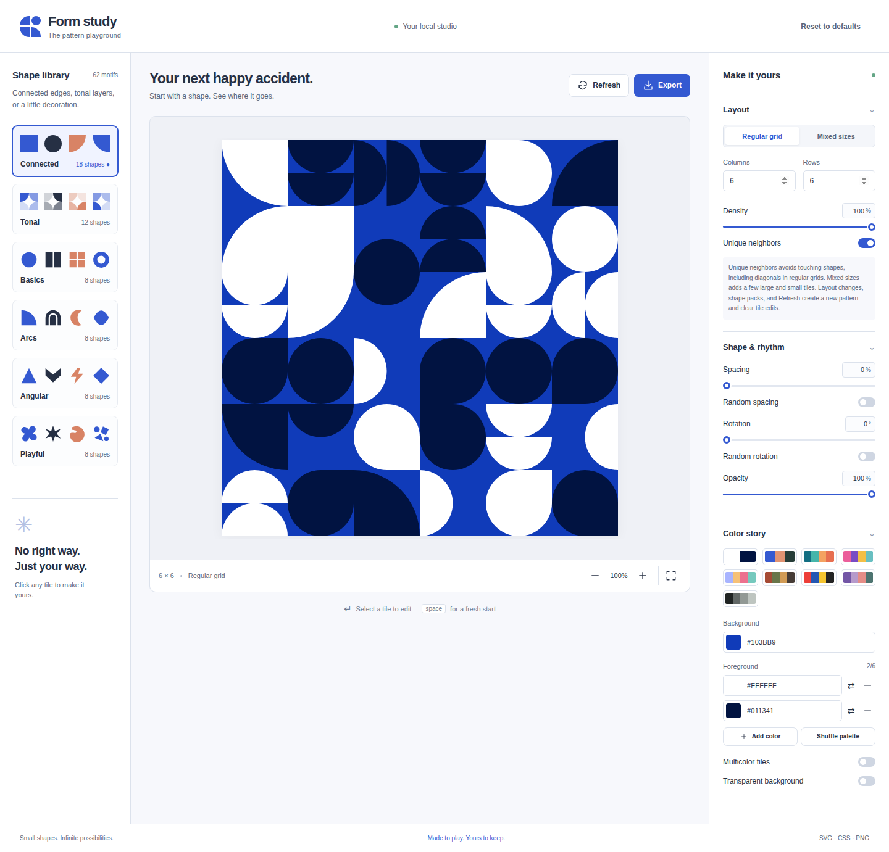
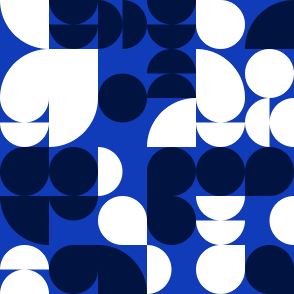
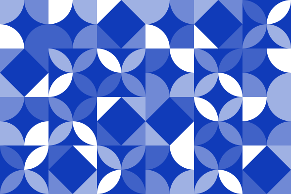
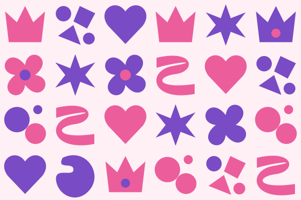
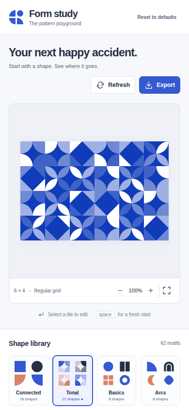

# Form study — Geometric Pattern Generator

**Create geometric patterns and abstract backgrounds in your browser. Export them as SVG, PNG, or ready-to-use CSS.**

Form study is a local-first pattern design tool for exploring connected curves, tonal shapes, and colorful geometric grids. Generate a composition, adjust its layout and palette, then edit individual tiles to make it your own. Use the results for website backgrounds, presentation graphics, posters, or other design experiments.

Built with React, TypeScript, and Vite. No account, API key, backend, or external graphics service is required.

## A look inside

[](docs/images/editor-desktop.png)

_The desktop editor: a generated 6 × 6 Connected composition, with shape, layout, and color controls alongside the canvas._

## Example patterns

These are actual SVG exports from the generator, not mockups. Click a preview to open the vector file.

| Connected · Ink                                                                                                                                             | Tonal · one foreground color                                                                                                                 | Playful · Candy                                                                                                                         |
| ----------------------------------------------------------------------------------------------------------------------------------------------------------- | -------------------------------------------------------------------------------------------------------------------------------------------- | --------------------------------------------------------------------------------------------------------------------------------------- |
| [](docs/images/connected.svg) | [](docs/images/tonal.svg) | [](docs/images/playful.svg) |
| 6 × 6 grid · seed 123                                                                                                                                       | 4 × 6 grid · seed 42                                                                                                                         | 4 × 6 grid · seed 987                                                                                                                   |

The Tonal example uses only white as its foreground color; its lighter and darker regions come from the motifs' built-in opacity. The Playful example uses multicolor parts and 12% spacing.

<details>
<summary>See the mobile editor</summary>

<p>
  <a href="docs/images/editor-mobile.png">
    
  </a>
</p>

The canvas comes first on small screens, with the shape library and editing controls below it.

</details>

## Features

- **62 geometric motifs across six shape packs**, from edge-reaching curves to decorative symbols.
- **Regular and mixed-size grids**, with 2–12 rows and columns, adjustable density, and optional neighbor uniqueness.
- **Color controls:** nine preset palettes, editable background, one to six foreground colors, multicolor motif parts, and per-tile color overrides.
- **Shape controls:** spacing, rotation, opacity, and stable randomized spacing or rotation.
- **Individual tile editing:** replace a motif, recolor it, or clear it without rebuilding the entire composition.
- **SVG, PNG, and CSS exports**, including transparent backgrounds.
- **Automatic local draft saving**, preserving the current composition and tile edits between visits.
- **Responsive editor with keyboard controls**, plus preview zoom and fit-to-view.

## Shape packs

| Pack          | Motifs | Visual style                                                                                                                                                          |
| ------------- | -----: | --------------------------------------------------------------------------------------------------------------------------------------------------------------------- |
| **Connected** |     18 | Full-tile squares, discs, quarter-discs, edge-anchored semicircles, paired semicircles, and rounded forms. Designed to meet tile boundaries without built-in gutters. |
| **Tonal**     |     12 | Quarter-disc, triangle, and lens compositions with four intrinsic opacity levels. Tonal detail remains visible with a single foreground color.                        |
| **Basics**    |      8 | Discs, split blocks, rings, steps, capsules, and other simple forms.                                                                                                  |
| **Arcs**      |      8 | Arches, crescents, waves, fans, and petals.                                                                                                                           |
| **Angular**   |      8 | Peaks, chevrons, bolts, diamonds, stairs, and other sharp-edged forms.                                                                                                |
| **Playful**   |      8 | Flowers, sparks, beans, confetti, and other decorative motifs.                                                                                                        |

New patterns start with **Connected**, a **3 × 4 regular grid**, and the blue, white, and navy **Ink** palette. Existing saved drafts keep their artwork and settings.

## Run locally

### Requirements

- Node.js **22.12+**, or a newer supported release compatible with Vite.
- npm and a modern web browser.

Download or clone this repository, open a terminal in its directory, then run:

```sh
npm ci
npm run dev
```

Open **http://localhost:3030**.

The editor runs in your browser. Its runtime does not use remote assets, accounts, uploads, or network APIs. Installing dependencies requires an internet connection unless they are already cached.

### Production build

```sh
npm run build
npm run preview
```

The production files are generated in `dist/` and can be served by a static web server. Both development and local production preview use port **3030** with strict port checking; stop the other server before switching between them.

## Create a pattern

1. **Choose a shape pack.** Start with Connected for bold geometric compositions or Tonal for layered opacity effects.
2. **Set the layout.** Adjust rows, columns, density, and regular or mixed-size tiles.
3. **Choose your colors.** Pick a palette or edit the background and foreground colors. Enable multicolor tiles to color motif parts separately.
4. **Adjust the rhythm.** Change spacing, rotation, or opacity. Enable random spacing or rotation for variation.
5. **Refine individual tiles.** Click a tile to choose its motif or color. Save applies the edit; Cancel or Escape discards it. Clear leaves an empty tile you can edit again.
6. **Export your artwork.** Choose SVG for vector editing, PNG for a raster image, or CSS for a repeating website background.

**Refresh generates a new composition and clears tile edits.** Changing the shape pack, dimensions, grid mode, density, or neighbor rules also regenerates tiles. Palette and appearance changes preserve tile placement and motif choices. Custom tile colors survive palette changes; choose **Automatic** in the tile editor to remove an override.

### Layout behavior

- **Mixed sizes** adds a restrained number of large and small tiles. At 3 × 4, it produces ten normal tiles and eight quarter-size tiles. Larger layouts can also include 2 × 2 merged tiles.
- **Unique neighbors** avoids repeated motif IDs along shared edges, and along diagonals in regular grids. Directional variants count as distinct motifs; this is not an edge-matching solver.
- **Connected and Tonal rotations** shrink nonzero rotations to 70% scale before applying spacing, keeping motif corners inside their tiles. The decorative packs retain their original rotation behavior.
- Random appearance factors stay stable while you adjust controls. Refresh changes the underlying seeded composition.

### Keyboard controls

| Action                                       | Control                                             |
| -------------------------------------------- | --------------------------------------------------- |
| Generate a new composition                   | **Space**, outside interactive controls and dialogs |
| Open a tile editor                           | **Tab** to a tile, then **Enter** or **Space**      |
| Dismiss a dialog without saving tile changes | **Escape**                                          |

Zoom and **Fit to view** affect only the preview, not exported artwork.

## Export formats

All exports use the same geometry, colors, opacity, and background settings as the preview. Transparent backgrounds are supported in every format; the preview checkerboard is never exported.

| Format  | What you get                                                                                                                                        | Useful for                                               |
| ------- | --------------------------------------------------------------------------------------------------------------------------------------------------- | -------------------------------------------------------- |
| **SVG** | Standalone vector artwork with per-tile clipping.                                                                                                   | Resizing and further editing in vector design tools.     |
| **PNG** | A raster image with a chosen width of **100–4096 px**; height follows the composition's aspect ratio. Exports above **16 megapixels** are rejected. | Presentations, images, and tools that do not accept SVG. |
| **CSS** | A `.pattern` class containing the composition as an SVG data URL, with background size and repeat declarations.                                     | Website and application backgrounds.                     |

For CSS exports, apply the downloaded or copied class to an element:

```html
<div class="pattern">Your content</div>
```

Give the element dimensions or content so its background is visible. If clipboard access is denied, the export dialog provides selectable CSS and a download option.

**Repeating does not mean seamless edge matching.** CSS repeats the entire rectangular composition; motifs on opposite edges are not guaranteed to connect. Connected refers to the pack's edge-reaching geometric vocabulary, not a seamless tiling guarantee.

## Privacy and saved drafts

Your current document is saved automatically to this browser's `localStorage` under `form-study:draft`. It includes settings, concrete tile layouts, colors, and manual edits. Valid drafts restore without regenerating the artwork. Invalid or unavailable storage produces a notice and safely starts a new pattern.

- No artwork is uploaded to a server by the application.
- There is **one current draft**, not a library of named projects.
- Storage belongs to this browser and origin. Changing browsers, domains, or ports does not transfer the draft.
- Clearing site data loses the saved draft. Private browsing and storage restrictions may prevent saving.
- **Reset to defaults replaces the current draft after confirmation.**

**Browser storage is not a backup.** Downloaded SVG, PNG, and CSS preserve artwork, not an editable Form study project. There is currently no project import/export, undo history, gallery, or cloud sync.

## Development and tests

```sh
npm test                         # Unit tests
npx playwright install chromium # One-time browser installation
npm run test:browser             # Browser tests and visual fixtures
npm run build                   # TypeScript check and production build
```

If the Playwright browser download is unavailable, point the tests at an installed compatible Chrome or Chromium executable:

```sh
PLAYWRIGHT_CHROMIUM_EXECUTABLE_PATH=/usr/bin/google-chrome npm run test:browser
```

Unit tests cover deterministic generation, mixed-grid counts and coverage, edge and diagonal neighbor rules, tonal opacity, rotation fitting, stable edits, palette remapping, exports, and saved-draft compatibility and validation.

Browser tests cover tile editing and reload, palettes, keyboard use, reset, responsive layouts, SVG/CSS equivalence, and PNG pixel parity. Visual fixtures use fixed seeds **42, 123, and 987**, including monochrome, tonal, mixed-size, and rotated compositions, plus a labeled motif atlas. Screenshots are written to `test-results/`.

### Source layout

| File                   | Responsibility                                                            |
| ---------------------- | ------------------------------------------------------------------------- |
| `src/core.ts`          | Document types, defaults, seeded generation, palettes, and state updates. |
| `src/shapes.ts`        | Shape packs and SVG motif definitions.                                    |
| `src/render.ts`        | Shared SVG/CSS rendering and export sizing.                               |
| `src/download.ts`      | Browser downloads and PNG rasterization.                                  |
| `src/persistence.ts`   | Draft validation and local storage.                                       |
| `src/App.tsx`          | Pattern editor and tile editing.                                          |
| `src/ExportDialog.tsx` | Export controls.                                                          |
| `src/style.css`        | Responsive editor styles.                                                 |

The project intentionally stays browser-only: no backend, database, accounts, or graphics-generation service to configure.
